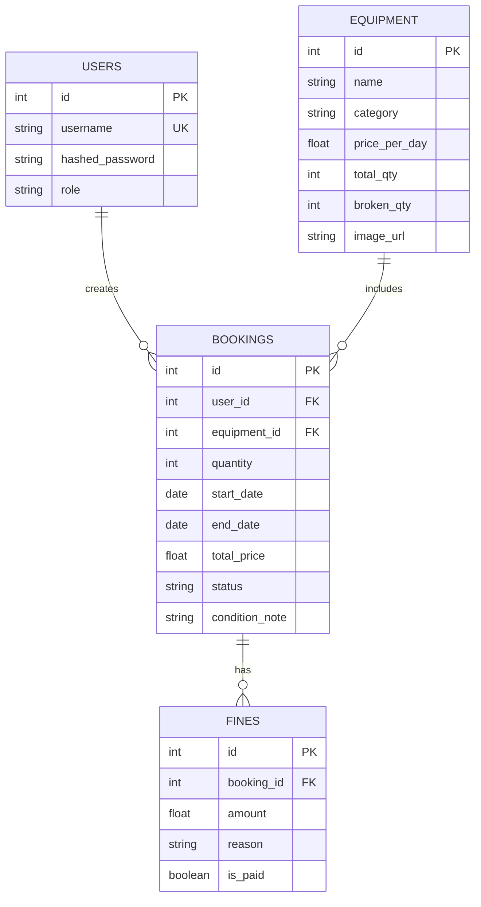

# Веб-приложение «Прокат оборудования» (FastAPI + SQLite)

Веб-система для автоматизации проката спортивного, туристического и строительного инвентаря: каталог с фильтрацией, бронирование с проверкой пересечения дат, контроль выдачи/возврата, расчёт штрафов и складской учёт.

## Установка и запуск

1. Установите зависимости:
```bash
pip install -r requirements.txt
```

2. Запустите сервер разработки:
```bash
uvicorn app.main:app --reload
```

3. Откройте приложение в браузере: `http://127.0.0.1:8000` (документация API доступна по адресу `http://127.0.0`).

## Демо-аккаунты

- **Администратор:** `admin` / `admin`
- **Менеджер:** `manager` / `manager`
- **Клиент:** `client` / `client`

## Запуск автотестов

```bash
pytest -v
```

## ER-диаграмма базы данных


